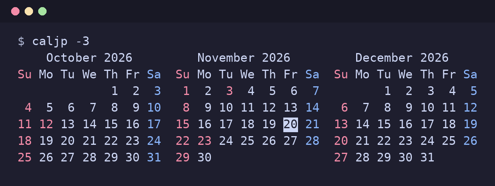

# caljp



[English](#english) | [日本語](#日本語)

## English

`caljp` is a clone of the BSD `cal` command written in Go. It colors Japanese public holidays, Saturdays and Sundays, and lets you choose the colors.

```
$ caljp
   November 2026
Su Mo Tu We Th Fr Sa
 1  2  3  4  5  6  7
 8  9 10 11 12 13 14
15 16 17 18 19 20 21
22 23 24 25 26 27 28
29 30
```

On a terminal, Sundays and holidays (the 3rd and 23rd above) are red, Saturdays are blue, and today is shown in reverse video.

### Install

With Homebrew, on macOS or Linux:

```sh
brew install 7milch/tap/caljp
```

On Ubuntu or Debian, install the `.deb` package (use `caljp_arm64.deb` on ARM). It does not update itself; run the same two lines again for a new release.

```sh
curl -LO https://github.com/7milch/caljp/releases/latest/download/caljp_amd64.deb
sudo apt install ./caljp_amd64.deb
```

Or download a binary from [Releases](https://github.com/7milch/caljp/releases) and put it on your `PATH`.

`go install github.com/7milch/caljp@latest` also works, but it builds the latest commit of `main` rather than a release, because Go does not recognise calendar versions as module versions.

### Usage

```
caljp                 this month
caljp 2027            the year 2027
caljp 3 2027          March 2027
caljp march           March of this year
```

| Option | Meaning |
|---|---|
| `-1` | One month (default) |
| `-3` | Previous, current and next month |
| `-y` | The whole year |
| `-A n`, `-B n` | Add `n` months after / before. Negative numbers are allowed: `caljp -y -B-6` shows July to December |
| `-m month` | Show this month. `8f` and `8p` mean August of the next / previous year |
| `-M`, `-S` | Weeks start on Monday / Sunday (default) |
| `-h` | Do not highlight today |
| `-j` | Show days of the year |
| `-w` | Show ISO 8601 week numbers |
| `--color when` | `auto` (default: color only on a terminal, and not when `NO_COLOR` is set), `always` or `never` |
| `--style spec` | Colors, see below |
| `--refresh` | Download the latest holiday list and exit |
| `--version`, `--help` | Print the version / the usage |

Short options can be combined (`-3M`) and values can be attached (`-A2`). Month and weekday names are always in English.

A year alone always means the whole year, so `-1` and `-3` need a month: `caljp -3 11 2027`. Whenever the range is exactly January to December, the year layout is used, with the year printed once at the top.

### Colors

`--style` takes `key=color` pairs separated by commas and applies them on top of the default `sun=red,sat=blue,holiday=red`.

- Keys: `sun` `mon` `tue` `wed` `thu` `fri` `sat` `holiday`
- Colors: `black` `red` `green` `yellow` `blue` `magenta` `cyan` `white`, and `none` to remove a color

A holiday color wins over the weekday color. `holiday=none` turns holiday coloring off. caljp only emits the eight basic ANSI colors, so the actual shades come from your terminal theme.

There is no configuration file. Put your preferences in an alias:

```sh
alias cal='caljp -M --style sat=cyan,sun=magenta,holiday=red'
```

### Compatibility with cal

caljp follows the **BSD** `cal` found on Ubuntu, Debian and macOS. It differs from the util-linux `cal` found on Fedora and Arch Linux, where `-m` means "Monday first" and `-s` means "Sunday first". In caljp `-m` selects a month, and Monday first is `-M`.

These `cal` / `ncal` options are recognised but not supported. caljp reports them instead of ignoring them:

`-J` (Julian calendar), `-e` `-o` (Easter), `-p` `-s` (Julian to Gregorian switch by country), `-W`, `-b` `-C` `-N` (ncal layouts), `-d` `-H` (debugging dates).

caljp uses the Gregorian calendar for every year from 1 to 9999, so September 1752 is not shortened.

### Holiday data

Holidays come from the list published by the Cabinet Office of Japan ([国民の祝日について](https://www8.cao.go.jp/chosei/shukujitsu/gaiyou.html), `syukujitsu.csv`). The list is built into the binary and covers 1955 up to the year after the release. Years outside it are shown without holiday colors.

`caljp --refresh` downloads the current list into your cache directory (`~/.cache/caljp/holidays.csv` on Linux, `~/Library/Caches/caljp/holidays.csv` on macOS). caljp never touches the network otherwise. Between the built-in list and the cache, it uses the one that reaches further into the future.

### Versioning and license

Releases use calendar versioning, `vYYYY.M.N` (for example `v2026.11.0`). A release is built automatically every month when the holiday list or the code has changed.

[MIT](LICENSE). Holiday data: Cabinet Office, Government of Japan.

## 日本語

`caljp` は BSD 版 `cal` コマンドを Go で書き直したものです。日本の祝日と土曜・日曜に色がつき、色は自分で選べます。

```
$ caljp
   November 2026
Su Mo Tu We Th Fr Sa
 1  2  3  4  5  6  7
 8  9 10 11 12 13 14
15 16 17 18 19 20 21
22 23 24 25 26 27 28
29 30
```

ターミナルでは、日曜と祝日（上の例では 3 日と 23 日）が赤、土曜が青、今日が反転表示になります。

### インストール

macOS でも Linux でも、Homebrew で入れられます。

```sh
brew install 7milch/tap/caljp
```

Ubuntu や Debian では `.deb` パッケージを入れられます（ARM では `caljp_arm64.deb`）。自動では更新されないので、新しい版を入れるときは同じ 2 行をもう一度実行してください。

```sh
curl -LO https://github.com/7milch/caljp/releases/latest/download/caljp_amd64.deb
sudo apt install ./caljp_amd64.deb
```

[Releases](https://github.com/7milch/caljp/releases) からバイナリをダウンロードして、`PATH` の通った場所に置く方法もあります。

`go install github.com/7milch/caljp@latest` でも入りますが、リリース版ではなく `main` の最新コミットがビルドされます。Go がカレンダーバージョンをモジュールのバージョンとして認識しないためです。

### 使い方

```
caljp                 今月
caljp 2027            2027 年の年間
caljp 3 2027          2027 年 3 月
caljp march           今年の 3 月
```

| オプション | 意味 |
|---|---|
| `-1` | 1 か月（既定） |
| `-3` | 前月・当月・翌月 |
| `-y` | 年間 |
| `-A n`、`-B n` | 後ろ / 前に `n` か月足す。負の数も使えます。`caljp -y -B-6` は 7 月から 12 月 |
| `-m 月` | 月を指定。`8f` は翌年、`8p` は前年の 8 月 |
| `-M`、`-S` | 月曜始まり / 日曜始まり（既定） |
| `-h` | 今日を強調しない |
| `-j` | 年初からの通し日で表示 |
| `-w` | ISO 8601 の週番号を表示 |
| `--color when` | `auto`（既定。ターミナルのときだけ色を出し、`NO_COLOR` があれば出さない）、`always`、`never` |
| `--style spec` | 色の指定（下記） |
| `--refresh` | 最新の祝日一覧をダウンロードして終了 |
| `--version`、`--help` | バージョン / 使い方を表示 |

1 文字のオプションはまとめて書けます（`-3M`）。値は詰めて書けます（`-A2`）。月名と曜日名は常に英語です。

年だけを指定すると必ず年間表示になるので、`-1` と `-3` には月も必要です（`caljp -3 11 2027`）。表示範囲がちょうど 1 月から 12 月のときは年間レイアウトになり、年は一番上に 1 回だけ表示されます。

### 色

`--style` には `キー=色` をカンマ区切りで渡します。既定の `sun=red,sat=blue,holiday=red` に上書きされます。

- キー: `sun` `mon` `tue` `wed` `thu` `fri` `sat` `holiday`
- 色: `black` `red` `green` `yellow` `blue` `magenta` `cyan` `white`、色を消す `none`

祝日の色は曜日の色より優先されます。`holiday=none` で祝日の色づけを切れます。caljp が出すのは ANSI の基本 8 色だけなので、実際の色合いはターミナルの配色テーマで決まります。

設定ファイルはありません。好みは alias に書いてください。

```sh
alias cal='caljp -M --style sat=cyan,sun=magenta,holiday=red'
```

### cal との互換性

caljp は Ubuntu、Debian、macOS に入っている **BSD 版** `cal` に合わせています。Fedora や Arch Linux の util-linux 版 `cal` とは違います。util-linux 版では `-m` が月曜始まり、`-s` が日曜始まりですが、caljp では `-m` は月の指定で、月曜始まりは `-M` です。

次の `cal` / `ncal` のオプションは認識しますが対応していません。無視はせず、未対応であることを表示します。

`-J`（ユリウス暦）、`-e` `-o`（イースター）、`-p` `-s`（国ごとのユリウス暦からグレゴリオ暦への切り替え）、`-W`、`-b` `-C` `-N`（ncal のレイアウト）、`-d` `-H`（デバッグ用の日付）。

1 年から 9999 年まですべてグレゴリオ暦で計算するので、1752 年 9 月は短くなりません。

### 祝日データ

祝日は内閣府が公開している一覧（[国民の祝日について](https://www8.cao.go.jp/chosei/shukujitsu/gaiyou.html) の `syukujitsu.csv`）を使っています。一覧はバイナリに組み込まれていて、1955 年からリリース時点の翌年までが対象です。それ以外の年は祝日の色がつきません。

`caljp --refresh` を実行すると、最新の一覧をキャッシュディレクトリ（Linux は `~/.cache/caljp/holidays.csv`、macOS は `~/Library/Caches/caljp/holidays.csv`）に保存します。それ以外のときにネットワークへ接続することはありません。組み込みの一覧とキャッシュのうち、より先の日付まで載っているほうを使います。

### バージョンとライセンス

リリースはカレンダーバージョニング `vYYYY.M.N`（例: `v2026.11.0`）です。祝日一覧かコードに変更があれば、毎月自動でリリースされます。

[MIT](LICENSE)。祝日データの出典: 内閣府。
